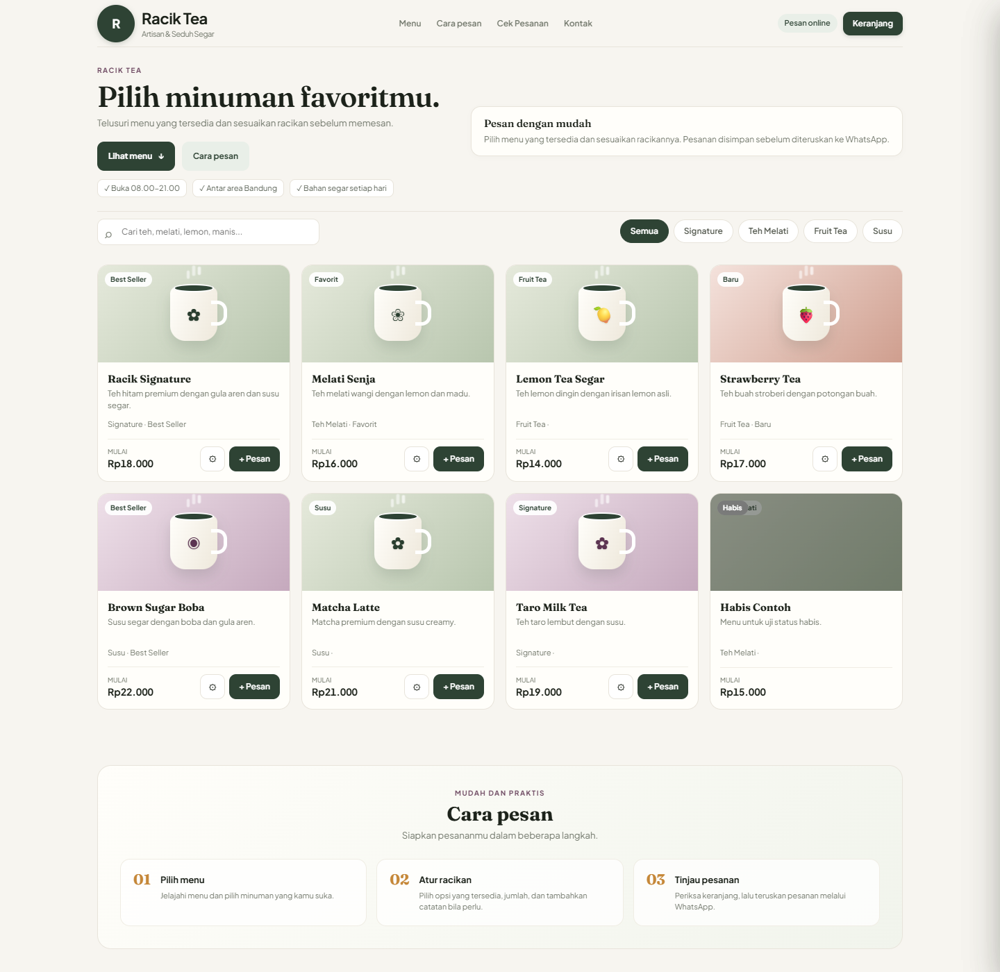
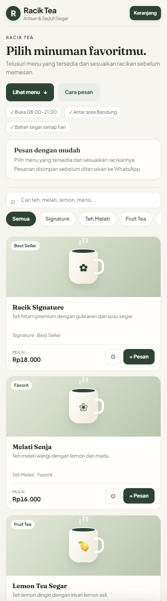
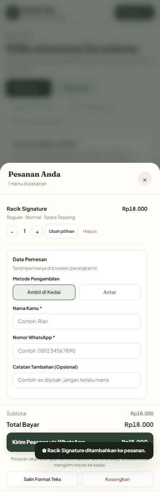
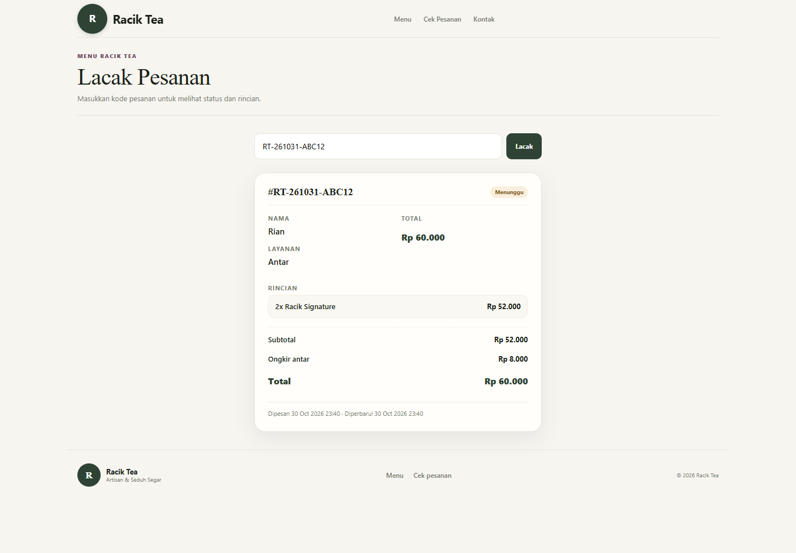
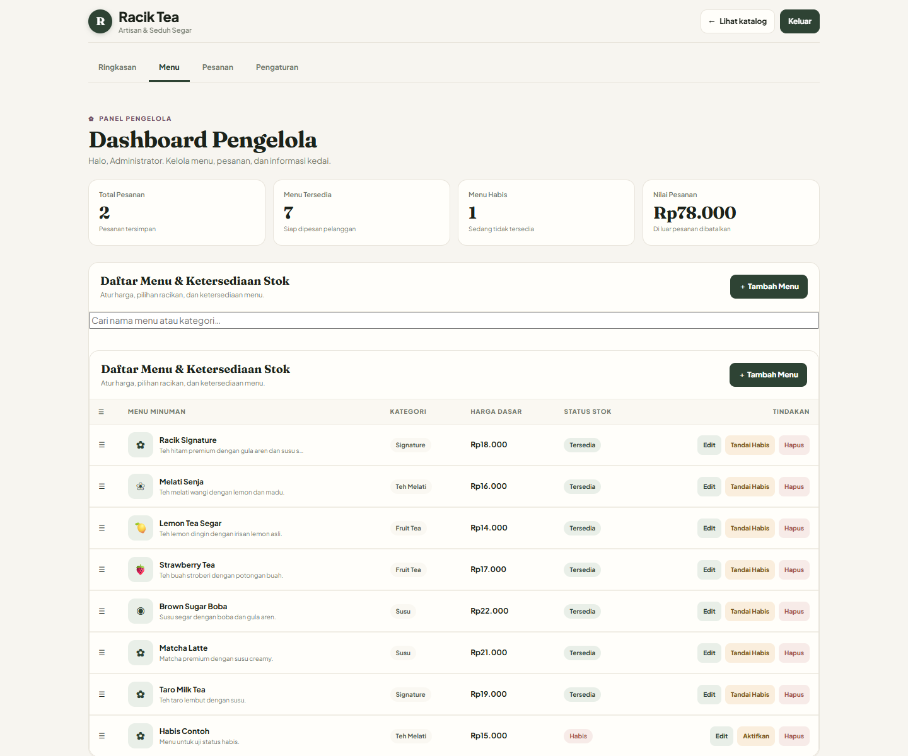
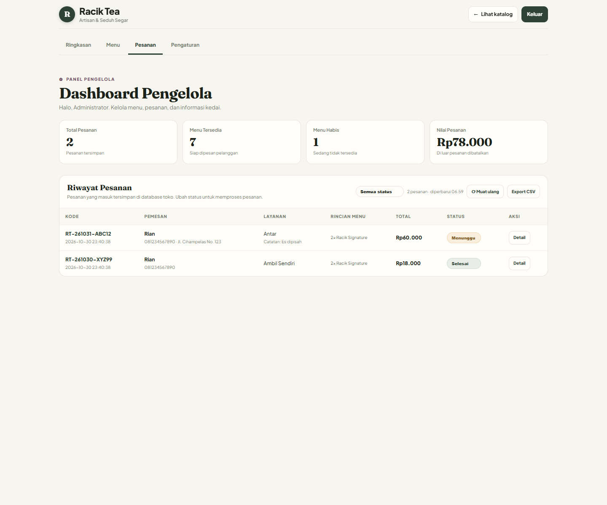
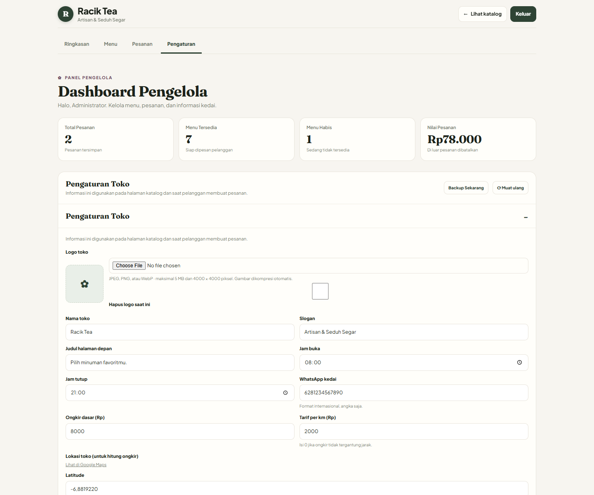
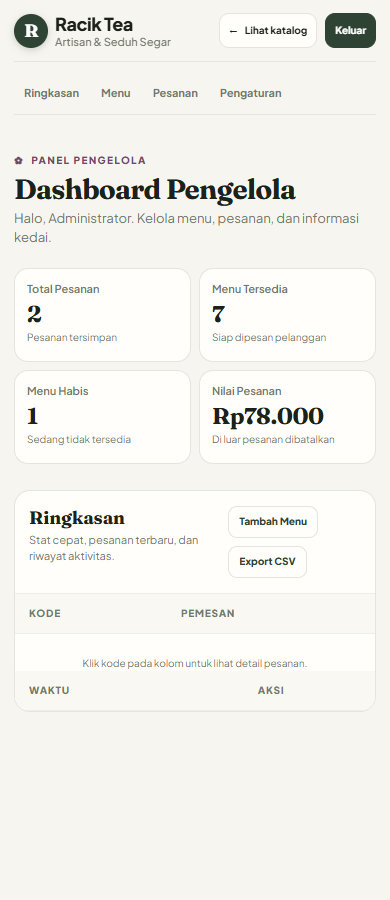

# Analisis UI/UX & Produk — Website Menu Order

**Status:** Draf untuk review bersama  
**Tanggal:** 31 Oktober 2026  
**Disusun dari sudut pandang:** UI/UX Designer & Product Manager  
**Cakupan:** katalog pelanggan, keranjang & checkout, halaman lacak pesanan, dashboard pengelola, kualitas kode yang berdampak ke pengalaman, SEO/shareability, dan kesiapan operasional.

> Dokumen ini **belum mengubah kode aplikasi**. Tujuannya menjadi bahan diskusi untuk menentukan prioritas bersama client/pengelola sebelum implementasi.

> **Catatan identitas:** nama toko pada aplikasi dibaca dari `store_settings.store_name` di database, bukan di-hardcode sebagai "Racik Tea". Data produksi saat review menampilkan **Chagow**. Aplikasi saat ini melayani satu toko; struktur data disiapkan agar bisa berkembang ke multi-toko di kemudian hari.

---

## 1. Ringkasan eksekutif

Secara visual, website ini sudah punya identitas yang kuat: hangat, bersih, terasa seperti kedai teh artisan, dan jauh di atas rata-rata website UMKM. Alur inti “pilih menu → atur racikan → keranjang → WhatsApp” juga sudah terbentuk.

Namun, untuk dipakai **setiap hari oleh pengelola** dan **oleh pelanggan awam di HP**, masih ada beberapa masalah yang bisa membuat pesanan terlewat, pelanggan bingung, atau pengelola kewalahan.

**Kesimpulan singkat:**

- **Layak demo / sudah menjual:** ya.
- **Siap operasional harian tanpa pendampingan:** belum.
- **Yang paling mendesak bukan menambah fitur baru**, tetapi memperbaiki 7 masalah kritis yang membuat alur yang sudah ada terasa tidak reliable.
- Setelah itu, enhancement paling bernilai adalah: **status buka/tutup yang jelas, navigasi mobile, halaman lacak yang lengkap, dashboard “Hari Ini” untuk pengelola, dan editor menu yang ramah non-teknis.**

### Skor subjektif saat ini

| Aspek | Skor | Catatan |
|---|---:|---|
| Identitas visual & first impression | 8/10 | Kuat, konsisten, terasa premium |
| Alur pemesanan pelanggan | 6,5/10 | Sudah jalan, tetapi ada friksi & risiko gagal di akhir |
| Pengalaman mobile pelanggan | 5/10 | Navigasi hilang, kartu terlalu tinggi, target sentuh kecil |
| Kejelasan informasi & kepercayaan | 5/10 | Jam buka, pembayaran, ongkir, status pesanan belum jelas |
| Kemudahan dashboard pengelola | 5/10 | Beberapa fitur inti rusak/tidak terlihat |
| Aksesibilitas | 5/10 | Kontras & ukuran teks/tombol perlu diperbaiki |
| Keandalan alur teknis | 5,5/10 | Ada celah popup WhatsApp, double order, data tidak konsisten |
| SEO & shareability | 4/10 | Meta, canonical, OG image, sitemap belum lengkap |
| Kesesuaian operasional kedai | 5,5/10 | Belum ada alert pesanan baru, cetak struk, laporan harian |

**Skor keseluruhan: ±5,6/10** — fondasi bagus, tetapi belum nyaman untuk operasional harian.

---

## 2. Metode & batasan review

Yang saya lakukan:

1. Membaca alur route, controller, service, request validation, view Blade, CSS, dan JavaScript.
2. Merender halaman utama pada viewport desktop **1440px** dan mobile **390px**.
3. Menguji halaman lacak pesanan, login pengelola, dashboard, tab menu, tab pesanan, dan tab pengaturan.
4. Menghitung kontras warna teks utama.
5. Memeriksa konsistensi copy, istilah, dan status.
6. Membandingkan implementasi dengan dokumen `PRD.md`, `README.md`, `FEATURE-GAP.md`, `HIGH-PRIORITY-ISSUES.md`, dan `docs/issues/seo-racik-tea_issue.md`.

Batasan:

- Belum ada wawancara langsung dengan pemilik kedai.
- Belum ada data analytics produksi (berapa order/hari, drop-off, pertanyaan pelanggan).
- Belum menguji pembayaran online karena memang belum ada.
- Screenshot memakai data demo lokal, bukan data produksi.

---

## 3. Kondisi saat ini — apa yang sudah bagus

Jangan rombak bagian ini tanpa alasan kuat.

| Aset | Mengapa bagus |
|---|---|
| Identitas visual | Palet hijau teh, krem, aksen emas/plum; tipografi Fraunces + Plus Jakarta Sans; terasa premium dan hangat |
| Struktur katalog | Hero → pencarian → kategori → grid produk → cara pesan → footer; mudah dipahami |
| Kartu produk | Menampilkan nama, deskripsi, kategori, label, harga “mulai”, tombol pesan, dan stepper |
| Modal racikan | Opsi ukuran, tingkat manis, topping; harga tambahan terlihat; qty dan total langsung berubah |
| Keranjang | Bottom sheet di mobile, drawer di desktop; ada edit, hapus, kosongkan, salin teks |
| Validasi server | Harga dihitung ulang di server; opsi divalidasi; tidak mempercayai total browser |
| Ongkir berbasis jarak | Ada geocoding, rute, batas jarak, quote kedaluwarsa, dan konfirmasi alamat |
| Keamanan dasar | CSRF, rate limit checkout/login/lookup, password admin dari env, activity log, backup |
| Aksesibilitas dasar | Focus trap di drawer/modal, Escape untuk menutup, `aria-*`, `prefers-reduced-motion` |
| Halaman lacak | Sudah ada halaman publik berbasis kode, status berwarna, rincian item, total |

**Rekomendasi:** pertahankan bahasa visual dan komponen yang sudah ada. Fokus perbaikan pada **kejelasan, keandalan, dan efisiensi operasional**, bukan redesign total.

---

## 4. Temuan kritis (P0) — perbaiki sebelum menambah fitur

### P0-01 — Detail pesanan di dashboard tidak bisa dibuka

**Bukti**

- Tombol “Detail” ada di tabel pesanan (`admin/partials/orders-rows.blade.php:18`).
- Dialog detail pesanan hanya ada di `admin/partials/orders.blade.php:24-59`.
- `admin.blade.php` **tidak meng-include** partial `orders`, hanya meng-include `orders-rows` (`admin.blade.php:90-97`).
- Akibatnya `document.getElementById('order-detail-dialog')` bernilai `null`, dan handler klik berhenti di `if (!button || !orderDetailDialog) return;` (`admin.js:327-345`).

**Dampak**

- Pengelola tidak bisa melihat alamat, nomor WhatsApp, catatan, rincian opsi, dan total pesanan.
- Pesanan hanya bisa diproses berdasarkan tabel ringkas; rawan salah buat minuman.
- Ini fitur inti operasional, bukan nice-to-have.

**Rekomendasi**

- Include dialog detail di halaman admin, atau pindahkan dialog ke partial yang selalu dirender.
- Tampilkan detail dalam **drawer/modal** yang bisa dibuka dari baris pesanan dan dari kartu “pesanan terbaru”.
- Di dalam detail, sediakan aksi: ubah status, hubungi pelanggan via WhatsApp, cetak struk, batalkan dengan alasan.

**Acceptance criteria**

- Klik “Detail” membuka dialog/drawer berisi data lengkap.
- Bisa ditutup dengan Escape, klik backdrop, dan tombol tutup.
- Fokus keyboard kembali ke tombol asal setelah ditutup.
- Berfungsi di mobile dan desktop.
- Ada test otomatis untuk membuka detail pesanan.

**Effort:** S (0,5–1 hari)

---

### P0-02 — Ringkasan “pesanan terbaru” dan “aktivitas terbaru” tidak termuat

**Bukti**

- `admin.js:500` menganggap respons `/admin/orders` adalah array atau punya properti `orders`:
  `(Array.isArray(data.orders) ? data.orders : data).slice(-5).reverse()`.
- Kenyataannya `OrderController@index` hanya mengembalikan `count`, `latest_id`, dan `revenue` (`OrderController.php:19-28`), bukan daftar order.
- Akibatnya `.slice` error dan ditangkap `catch`, sehingga tabel ringkasan kosong.

**Dampak**

- Halaman pertama dashboard terlihat kosong, padahal ada pesanan.
- Pengelola mengira belum ada order, padahal order masuk.
- Kepercayaan terhadap dashboard turun.

**Rekomendasi**

- Pisahkan endpoint: satu untuk statistik ringan, satu untuk daftar pesanan terbaru.
- Atau kirim `orders` (5 terbaru) di respons statistik.
- Tampilkan empty state yang jelas: “Belum ada pesanan hari ini” + ajakan ke tab Pesanan.

**Acceptance criteria**

- Lima pesanan terbaru tampil di Ringkasan.
- Angka statistik dan daftar konsisten.
- Ada loading state, empty state, dan error state dengan tombol “Coba lagi”.

**Effort:** S

---

### P0-03 — Tombol “Export CSV” di Ringkasan rusak

**Bukti**

- `admin.js:468` berisi:
  `window.location.href = "{{ route('admin.orders.export') }}";`
- File `admin.js` adalah aset statis di `public/assets/admin/`, sehingga sintaks Blade `{{ ... }}` **tidak pernah dirender**.
- Klik tombol akan mengarah ke URL literal `{{ route('admin.orders.export') }}`.

**Dampak**

- Fitur ekspor yang terlihat di UI tidak berfungsi.
- Pengelola tidak bisa mengambil data untuk rekap.

**Rekomendasi**

- Ganti dengan URL statis `/admin/orders/export`, atau taruh URL di `data-export-url` pada elemen HTML yang dirender Blade.
- Tambahkan filter tanggal/status saat export agar lebih berguna.

**Acceptance criteria**

- Klik “Export CSV” mengunduh file CSV.
- File bisa dibuka di Excel dan karakter Indonesia benar.
- Tidak ada Blade directive di file statis.

**Effort:** XS (1–2 jam)

---

### P0-04 — Status buka/tutup tidak akurat; pelanggan baru tahu toko tutup di akhir checkout

**Bukti**

- Badge header selalu “Pesan online” (`catalog.blade.php:46`), tidak pernah dihitung dari jam operasional.
- `StoreConfigController` sudah mengirim `open_time` dan `close_time` (`StoreConfigController.php:44-45`), tetapi `catalog.js` tidak memakainya.
- Validasi tutup hanya terjadi di server saat checkout (`OrderService::ensureStoreIsOpen`, `OrderService.php:171-196`).
- Saat review (±06.59 waktu server), toko dengan jam 08.00–21.00 tetap menampilkan “Pesan online” dan mengizinkan pelanggan mengisi keranjang.

**Dampak**

- Pelanggan menyusun pesanan, mengisi data, lalu ditolak di akhir. Ini salah satu friksi terburuk dalam e-commerce.
- Pelanggan mengira bisa memesan, lalu kecewa.
- Pengelola tetap menerima chat “kenapa tidak bisa pesan?”.

**Rekomendasi**

- Hitung status buka/tutup di frontend dari `open_time`/`close_time` dan timezone toko.
- Tampilkan badge dinamis:
  - Buka: “Buka • sampai 21.00”
  - Tutup: “Tutup • buka besok 08.00”
- Saat tutup:
  - Tetap izinkan melihat menu dan mengisi keranjang (opsional).
  - Nonaktifkan tombol checkout dengan penjelasan jelas.
  - Tawarkan “Pesan untuk besok” jika client ingin pre-order.
- Tambahkan tombol darurat **“Tutup sementara”** di admin (misalnya habis bahan/ramai).

**Acceptance criteria**

- Badge berubah otomatis sesuai jam toko.
- Checkout diblokir dengan pesan yang menjelaskan jam buka.
- Server tetap menolak order di luar jam (defense in depth).
- Ada test untuk dalam jam, luar jam, dan overnight.

**Effort:** S–M

---

### P0-05 — Handoff ke WhatsApp tidak andal; keranjang bisa hilang & order bisa dobel

**Bukti**

- `window.open(url, "_blank", ...)` dipanggil **setelah** `await fetch` (`catalog.js:1063-1104`). Browser modern sering memblokir popup yang tidak dipicu langsung oleh gesture user.
- Keranjang sudah dikosongkan **sebelum** WhatsApp dipastikan terbuka (`catalog.js:1096-1100`).
- Tidak ada state loading/disabled pada tombol checkout, sehingga double-click bisa membuat dua order.
- Pesan WhatsApp memakai subtotal dan harga dari keranjang client (`catalog.js:1073-1078`), bukan dari respons server. Jika harga berubah, teks WhatsApp bisa berbeda dari total yang tersimpan.

**Dampak**

- Order tersimpan di database, tetapi pelanggan tidak berhasil mengirim pesan ke kedai.
- Keranjang hilang, pelanggan bingung, dan mungkin mengulang order.
- Pesanan ganda / data tidak konsisten.

**Rekomendasi**

- Buka tab WhatsApp **sebelum** request async, lalu isi URL setelah order berhasil; atau gunakan redirect `window.location.href` ke `wa.me` setelah sukses.
- Jika popup diblokir, tampilkan halaman sukses dengan:
  - Kode pesanan
  - Tombol “Buka WhatsApp”
  - Tombol “Salin rincian”
  - Link “Lacak pesanan”
- Jangan kosongkan keranjang sampai order sukses dan WhatsApp berhasil dibuka.
- Disable tombol + spinner saat submit.
- Gunakan **idempotency key** per checkout untuk mencegah order ganda.
- Bangun teks WhatsApp dari data order yang dikembalikan server, bukan dari cart client.

**Acceptance criteria**

- Satu klik = maksimal satu order.
- Jika popup diblokir, pelanggan tetap mendapat kode dan cara mengirim pesanan.
- Teks WhatsApp sama dengan total yang tersimpan.
- Keranjang tidak hilang saat gagal.

**Effort:** M

---

### P0-06 — Halaman lacak tidak menampilkan informasi yang dibutuhkan pelanggan

**Bukti**

- `track.blade.php:64-71` hanya menampilkan `quantity`, `name`, dan `subtotal`.
- Opsi racikan (ukuran, manis, topping), catatan per item, alamat, dan catatan umum tidak ditampilkan.
- Tanggal memakai format Carbon default berbahasa Inggris: “30 Oct 2026 23:40” (`track.blade.php:89`).
- Tidak ada timeline status, estimasi waktu, kontak kedai, atau tombol “Pesan lagi”.

**Dampak**

- Pelanggan tidak bisa memverifikasi apakah pesanannya benar.
- Pelanggan harus chat ulang untuk memastikan “Less Sugar” atau “Boba” tercatat.
- Halaman terasa seperti struk setengah jadi, bukan halaman pelacakan.

**Rekomendasi**

- Tampilkan:
  - Opsi per item dan catatan.
  - Alamat/ambil di kedai.
  - Status timeline: Menunggu → Dikonfirmasi → Diproses → Siap/Dikirim → Selesai.
  - Estimasi waktu / jam siap.
  - Tombol “Hubungi kedai via WhatsApp”.
  - Tombol “Pesan lagi”.
  - Kode pesanan yang bisa disalin.
- Gunakan format tanggal Indonesia: `31 Okt 2026, 06.59`.
- Auto-refresh status ringan setiap 30–60 detik.
- Tambahkan `noindex` agar halaman pesanan tidak masuk mesin pencari.

**Acceptance criteria**

- Semua opsi dan catatan tampil.
- Status berubah tanpa reload (opsional).
- Ada kontak kedai dan aksi pesan lagi.
- Tanggal berbahasa Indonesia.
- Halaman tidak diindeks.

**Effort:** M

---

### P0-07 — Ada dua versi katalog; dokumen SEO mengarah ke file yang salah

**Bukti**

- Route `/` merender `resources/views/catalog.blade.php` (`routes/web.php:23-29`).
- `public/index.html` adalah salinan lama yang masih berisi sintaks Blade `{{ url()->current() ... }}` (`public/index.html:11`) dan tidak memiliki elemen ongkir yang dipakai `catalog.js`.
- `README.md:57` menyebut katalog pelanggan adalah `public/index.html` statis — tidak sesuai dengan route aktif.
- `docs/issues/seo-racik-tea_issue.md` menyuruh mengedit `public/index.html`, padahal halaman yang tampil adalah `catalog.blade.php`.

**Dampak**

- Perbaikan SEO/meta bisa dikerjakan di file yang tidak pernah tampil.
- Developer baru bingung mana sumber kebenaran.
- Risiko `index.html` ter-serve oleh konfigurasi server tertentu dan menampilkan halaman rusak.

**Rekomendasi**

- Jadikan `catalog.blade.php` satu-satunya sumber katalog.
- Hapus `public/index.html` atau redirect ke `/`.
- Perbarui README, dokumen SEO, dan dokumen fitur agar sesuai kondisi aktual.
- Tambahkan catatan arsitektur singkat: “Katalog = Blade + `public/assets/catalog/*`; tidak ada build step.”

**Acceptance criteria**

- Hanya ada satu implementasi katalog.
- Dokumen tidak lagi menunjuk file yang salah.
- Tidak ada sintaks Blade di file statis.

**Effort:** S

---

## 5. Temuan prioritas tinggi (P1) — pengalaman pelanggan

### C-01 — Navigasi utama hilang di mobile

**Bukti:** `.site-nav { display: none; }` pada `max-width: 768px` (`catalog.css:1759`). Di screenshot mobile, hanya logo dan tombol Keranjang yang terlihat.

**Dampak:** “Cek Pesanan” dan “Kontak” tidak bisa diakses dari header. Pelanggan harus scroll sampai footer. Ini menyulitkan pelanggan yang ingin melacak pesanan.

**Rekomendasi:** Tambahkan salah satu:
- Bottom navigation mobile: Menu · Lacak · Keranjang · Kontak.
- Atau hamburger menu dengan drawer.
- Minimal: tombol “Lacak” di header mobile.

**Effort:** S–M

---

### C-02 — Kartu produk terlalu tinggi di mobile; satu produk hampir satu layar

**Bukti:** Grid mobile satu kolom; tinggi kartu ±400px. Delapan menu berarti scroll sangat panjang.

**Dampak:** Pelanggan sulit membandingkan menu dan cepat lelah scroll. Waktu menuju checkout meningkat.

**Rekomendasi:**
- Gunakan **2 kolom** di mobile dengan gambar lebih pendek, atau
- Kartu horizontal ringkas: gambar 80×80, nama/harga di kanan, tombol “+”.
- Pertahankan deskripsi singkat; sembunyikan detail panjang di modal.
- Tambahkan sticky category + search yang lebih ringkas.

**Effort:** M

---

### C-03 — Toast menutupi tombol checkout

**Bukti:** `.toast` memakai `bottom: calc(80px + safe-area)` dan `z-index: 60`, sedangkan drawer `z-index: 41`. Di screenshot keranjang mobile, toast “Racik Signature ditambahkan…” menutupi tombol “Kirim Pesanan via WhatsApp”.

**Dampak:** Pelanggan bisa gagal menekan CTA utama, atau mengira tombol tidak berfungsi.

**Rekomendasi:**
- Pindahkan toast ke atas (top center) saat drawer terbuka, atau
- Beri `pointer-events: none` pada toast, dan
- Hitung offset dari tinggi drawer footer, bukan angka tetap 80px.

**Effort:** XS

---

### C-04 — Badge “Habis” menimpa label kategori

**Bukti:** `.tag` dan `.sold-badge` sama-sama `position: absolute; left: 10px; top: 10px` (`catalog.css:584-596`, `627-639`). Di screenshot, label “Signature” tertutup badge “Habis”.

**Dampak:** Informasi kategori hilang; tampilan terlihat bug.

**Rekomendasi:** Saat produk habis, sembunyikan `.tag` dan tampilkan badge “Habis” di posisi yang sama; atau pindahkan badge ke kanan atas. Jangan biarkan dua elemen bertumpuk.

**Effort:** XS

---

### C-05 — Informasi pembayaran, ongkir, minimal order, dan estimasi waktu belum jelas

**Bukti:** Checkout hanya menampilkan subtotal, ongkir, dan total. Tidak ada info metode pembayaran, batas minimal order, estimasi siap/delivery, atau kebijakan pembatalan.

**Dampak:** Pelanggan bertanya via WhatsApp sebelum memesan. Pengelola menjawab pertanyaan yang sama berulang kali. Konversi turun.

**Rekomendasi:**
- Di drawer checkout, tampilkan:
  - “Pembayaran: tunai / QRIS di kedai” (sesuai keputusan client).
  - “Minimal order antar: Rp …” jika ada.
  - “Estimasi siap: 15–25 menit” atau “Estimasi antar: 30–45 menit”.
  - “Gratis ongkir untuk …” jika ada promo.
- Di footer: alamat, jam buka, WhatsApp, link Google Maps.
- Tambahkan halaman/FAQ singkat “Cara pesan & pembayaran”.

**Effort:** S–M (tergantung keputusan bisnis)

---

### C-06 — Label “Wajib” pada grup topping menyesatkan

**Bukti:** Semua grup opsi diberi badge “Wajib” (`catalog.js:500`), termasuk grup “Topping” yang punya opsi “Tanpa Topping”.

**Dampak:** Pelanggan mengira harus memilih topping berbayar, atau bingung apakah “Tanpa Topping” valid.

**Rekomendasi:**
- Bedakan grup **wajib** dan **opsional** di data, bukan hardcode “Wajib”.
- Untuk grup opsional, tampilkan “Opsional” dan opsi “Tanpa …” sebagai default.
- Untuk grup wajib, tampilkan “Pilih satu”.
- Jika semua grup wajib, ubah copy menjadi “Pilih satu” agar lebih netral.

**Effort:** S

---

### C-07 — Copy privasi “Tersimpan hanya di browser/perangkat ini” menyesatkan

**Bukti:** `catalog.blade.php:145` menyatakan data pemesan hanya tersimpan di browser. Padahal nama, telepon, alamat, dan order disimpan di database server (`OrderService.php:90-107`).

**Dampak:** Masalah kepercayaan dan potensi masalah kepatuhan privasi. Pelanggan bisa merasa dibohongi.

**Rekomendasi:** Ganti dengan copy yang jujur:
> “Data ini dipakai untuk memproses pesanan dan disimpan di sistem kedai. Kami juga menyimpannya di perangkat ini agar pemesanan berikutnya lebih cepat.”

Tambahkan checkbox persetujuan singkat sebelum checkout:
> “Saya setuju data dipakai untuk memproses pesanan ini.”

**Effort:** XS

---

### C-08 — Riwayat pesanan bisa diakses hanya dengan nomor WhatsApp

**Bukti:** `POST /api/orders/lookup` mencari order berdasarkan nomor telepon dan mengembalikan hingga 50 order (`OrderLookupController.php:30-52`).

**Dampak:** Siapa pun yang tahu/menebak nomor pelanggan bisa melihat kode pesanan, status, total, dan item. Risiko privasi.

**Rekomendasi:**
- Untuk MVP: minta **nomor WhatsApp + 4 digit terakhir kode pesanan**, atau
- Kirim OTP via WhatsApp (butuh API, di luar scope awal), atau
- Tampilkan hanya setelah pelanggan memasukkan kode pesanan spesifik.
- Rate limit lebih ketat + CAPTCHA sederhana jika perlu.

**Effort:** S–M

---

### C-09 — Halaman lacak belum menjadi “halaman status” yang meyakinkan

**Bukti:** Lihat P0-06. Tidak ada timeline, ETA, kontak, atau aksi lanjutan.

**Rekomendasi:** Jadikan halaman ini pusat pasca-order:
- Timeline status vertikal.
- Kartu ringkasan pesanan.
- Tombol “Hubungi kedai”, “Pesan lagi”, “Salin kode”.
- Auto-refresh.
- Tampilan mobile-first.

**Effort:** M

---

### C-10 — Pencarian & kategori belum membantu keputusan

**Bukti:** Search hanya filter teks; tidak ada tombol clear, jumlah hasil, filter “tersedia saja”, atau indikator scroll pada kategori yang overflow di mobile.

**Rekomendasi:**
- Tambahkan tombol “×” di search.
- Tampilkan “8 menu ditemukan”.
- Tambahkan toggle “Sembunyikan yang habis”.
- Beri fade/arrow di category nav yang bisa di-scroll.
- Pertahankan kategori aktif saat kembali dari modal.

**Effort:** S

---

### C-11 — Belum ada promo, banner, favorit, atau “pesan lagi”

**Dampak:** Tidak ada alasan untuk kembali; pelanggan harus mencari ulang menu favorit.

**Rekomendasi (bertahap):**
- Banner promo di atas katalog (dikelola dari admin).
- Label “Best Seller”, “Baru”, “Promo” (sudah ada label, tinggal dimanfaatkan).
- “Pesan lagi” dari halaman lacak/riwayat.
- Favorit (localStorage dulu, akun nanti).

**Effort:** M

---

### C-12 — Empty/error/loading state belum konsisten

**Bukti:** Katalog punya skeleton dan empty state yang cukup baik. Namun dashboard dan beberapa fetch lain gagal secara diam-diam (mis. ringkasan pesanan), tanpa pesan retry.

**Rekomendasi:**
- Standarkan 4 state: loading, empty, error, success.
- Selalu beri aksi “Coba lagi” pada error.
- Jangan biarkan area kosong tanpa penjelasan.

**Effort:** S

---

### C-13 — Aksesibilitas: kontras, ukuran teks, dan target sentuh

**Bukti:**
- Warna `--muted: #73796d` di atas `--paper: #f7f5f0` memiliki rasio kontras **4,11:1**; di atas putih **4,44:1** — di bawah WCAG AA 4,5:1 untuk teks normal.
- Warna emas `#c58738` di atas krem hanya **2,79:1**.
- Banyak teks 10–12px.
- Tombol seperti `.btn-add` 36px, `.btn-close` 34px, `.btn-sm-step` 26px — di bawah rekomendasi 44×44px untuk touch target.

**Rekomendasi:**
- Gelapkan `--muted` menjadi sekitar `#5f665a` atau lebih gelap.
- Gunakan emas lebih gelap untuk teks (mis. `#8a5a1f`).
- Naikkan base body minimal 15–16px di mobile; meta minimal 12px.
- Target sentuh minimal 44×44px untuk aksi utama.
- Pertahankan focus ring yang sudah ada.
- Uji dengan keyboard dan screen reader.

**Effort:** S–M

---

### C-14 — Teks WhatsApp memakai harga dari client, bukan server

**Bukti:** `catalog.js:1073-1078` menghitung subtotal dari cart, lalu `delivery = savedOrder.total - subtotal`. Item dan harga di pesan memakai `it.price` dari client.

**Dampak:** Jika harga berubah di database antara add-to-cart dan checkout, pesan WhatsApp bisa berbeda dari total server.

**Rekomendasi:** Server mengembalikan `items`, `subtotal`, `service_fee`, `total`, dan `summary_text` (atau data terstruktur) yang siap dipakai untuk WhatsApp. Client hanya menampilkan.

**Effort:** S

---

## 6. Temuan prioritas tinggi (P1) — dashboard pengelola

### A-01 — Tidak ada alert pesanan baru

**Bukti:** Dashboard polling setiap 20 detik (`admin.js:229`), tetapi hanya memperbarui angka. Tidak ada suara, toast, title badge, atau browser notification.

**Dampak:** Pengelola bisa melewatkan pesanan saat sibuk. Ini risiko operasional terbesar.

**Rekomendasi:**
- Saat `latest_id` berubah: mainkan suara singkat, tampilkan toast, ubah `document.title` menjadi “(2) Pesanan baru”.
- Tambahkan tombol mute.
- Opsional: browser notification setelah izin user.
- Tampilkan badge jumlah “Menunggu” di tab Pesanan.

**Effort:** S–M

---

### A-02 — Tabel pesanan belum mendukung pencarian, filter tanggal, dan pagination

**Bukti:** `DashboardController@index` mengambil **semua** order (`DashboardController.php:20`). Filter status hanya client-side (`admin.js:483-491`). Tidak ada search, date range, atau pagination.

**Dampak:** Saat order menumpuk, dashboard melambat dan pengelola sulit menemukan pesanan lama.

**Rekomendasi:**
- Server-side pagination + filter: status, tanggal, pencarian nama/telepon/kode.
- Tampilkan jumlah per status.
- Default: “Hari ini” dan “Perlu diproses”.
- Tambahkan bulk action (tandai diproses/selesai).

**Effort:** M

---

### A-03 — Edit opsi racikan memakai JSON mentah, sedangkan tambah menu memakai builder

**Bukti:** Form tambah menu punya builder grup/opsi (`admin.js:119-185`). Form edit hanya textarea JSON (`menu-table.blade.php:47`).

**Dampak:** Pengelola non-teknis tidak bisa mengubah opsi tanpa risiko merusak JSON. Ini salah satu friksi terbesar untuk client.

**Rekomendasi:**
- Gunakan builder yang sama untuk edit.
- Tambahkan **preset opsi** yang bisa dipakai ulang: Ukuran, Tingkat Manis, Es, Topping.
- Validasi di client + server.
- Tampilkan preview hasil racikan.

**Effort:** M

---

### A-04 — Duplikasi heading, tombol, dan ID di halaman Menu & Pengaturan

**Bukti:**
- `admin.blade.php:57-69` membungkus `menu-table` yang sudah punya panel heading + tombol “Tambah Menu” sendiri (`menu-table.blade.php:1-5`). Hasilnya heading dan tombol muncul dua kali.
- `admin.blade.php:100-114` dan `settings.blade.php:33-42` sama-sama merender tombol Backup dengan ID `backup-now`/`backup-refresh` yang duplikat.
- Duplikasi ID membuat JavaScript hanya mengikat elemen pertama; elemen kedua tidak berfungsi.

**Dampak:** Tampilan terlihat belum rapi; sebagian tombol tidak berfungsi; invalid HTML.

**Rekomendasi:**
- Pilih satu pola: partial berisi **isi panel saja**, atau partial berisi **panel lengkap**.
- Hapus heading/tombol duplikat.
- Pastikan setiap ID unik; gunakan class untuk selector berulang.
- Tambahkan test HTML validasi ID duplikat (opsional).

**Effort:** S

---

### A-05 — Pengaturan toko terlalu teknis dan menyembunyikan variabel penting

**Bukti:**
- Latitude/longitude ditampilkan sebagai angka mentah (`settings.blade.php:22-23`).
- `delivery_included_km`, `delivery_rounding_km`, `delivery_max_km` hanya hidden input (`settings.blade.php:26-28`) — padahal memengaruhi harga ongkir.
- Backup database ditempatkan di dalam form pengaturan.
- File input masih native “Choose File”.
- Tidak ada preview perubahan katalog.

**Dampak:** Client tidak paham harus mengisi apa; salah setting ongkir bisa merugikan.

**Rekomendasi:**
- Kelompokkan pengaturan: **Profil**, **Jam Operasional**, **Pengantaran**, **Pembayaran**, **Kontak & Lokasi**, **Tampilan**.
- Ganti lat/long dengan **map picker** atau tombol “Gunakan lokasi saat ini” + alamat.
- Tampilkan field ongkir lanjutan dengan penjelasan sederhana.
- Pindahkan Backup ke tab **Sistem**.
- Tambahkan preview kartu katalog di samping form.
- Gunakan komponen upload yang konsisten (drag/drop, preview, crop).

**Effort:** M–L

---

### A-06 — Kategori dan opsi belum punya master data

**Bukti:** Kategori dibuat otomatis dari teks bebas saat simpan produk (`ProductController::syncCategory`, `ProductController.php:136-140`). Tidak ada UI kelola kategori. Opsi disimpan JSON per produk.

**Dampak:** Typo membuat kategori baru; sulit menjaga konsistensi menu; edit massal sulit.

**Rekomendasi:**
- CRUD kategori (nama, urutan, aktif).
- Master opsi reusable + assign ke produk.
- Bulk edit harga/kategori/status.
- Duplicate menu.

**Effort:** M–L

---

### A-07 — Belum ada cetak struk / kitchen ticket

**Dampak:** Pengelola harus mencatat manual dari layar; rawan salah.

**Rekomendasi:**
- Tombol “Cetak” di detail pesanan.
- Layout struk 58/80mm dan kitchen ticket (tanpa harga, perbesar opsi/catatan).
- Bisa print dari browser (window.print) untuk MVP.

**Effort:** S–M

---

### A-08 — Status pesanan terlalu kasar & tidak ada alasan pembatalan

**Bukti:** Status hanya `pending`, `processing`, `completed`, `cancelled` (`OrderStatus.php:23-31`).

**Dampak:** Pelanggan tidak tahu apakah pesanan sudah dikonfirmasi, sedang dibuat, siap, atau dikirim. Pembatalan tanpa alasan menyulitkan audit.

**Rekomendasi:**
- Tambah status: `confirmed`, `ready`, `delivering` (sesuai layanan).
- Simpan `cancelled_reason`, `cancelled_by`, `cancelled_at`.
- Simpan riwayat perubahan status.
- Tampilkan timeline yang sama di halaman lacak.

**Effort:** M

---

### A-09 — Dashboard mobile belum nyaman

**Bukti:** Tabel admin tetap lebar dan hanya bisa di-scroll horizontal. Di screenshot mobile, kolom Layar/Rincian/Total/Status tidak terlihat tanpa scroll.

**Rekomendasi:**
- Ubah tabel menjadi **card list** di mobile: kode, nama, total, status, aksi.
- Sticky filter di atas.
- Tombol aksi besar (44px).
- Detail pesanan sebagai bottom sheet.

**Effort:** M

---

### A-10 — Branding login masih hardcoded “Toko”

**Bukti:** `login.blade.php:6` title “Masuk Pengelola · Toko”; baris 27 “informasi kedai Toko”; baris 56 footer “Toko · Diracik Perlahan, Diseduh Segar”.

**Dampak:** Terlihat tidak selesai dan membingungkan saat nama toko bukan “Toko”.

**Rekomendasi:** Gunakan `$storeName` dan `$storeTagline` di semua copy login.

**Effort:** XS

---

### A-11 — Tidak ada kontrol “tutup sementara” / pause order

**Dampak:** Saat bahan habis atau kedai sangat ramai, pengelola tetap menerima order dan harus membatalkan manual.

**Rekomendasi:** Toggle “Terima pesanan” di header dashboard, dengan alasan opsional. Status ini langsung tampil di katalog.

**Effort:** S

---

### A-12 — Activity log menampilkan kode teknis dan IP

**Bukti:** `admin.js:433-441` menampilkan `log.action` mentah (mis. `created_product`) dan IP.

**Dampak:** Sulit dibaca pengelola non-teknis.

**Rekomendasi:** Map aksi ke label manusiawi (“Menambah menu”), sembunyikan IP di balik “detail”, tambahkan filter tanggal/admin.

**Effort:** S

---

### A-13 — Export CSV terlalu dasar

**Bukti:** Export hanya kolom kode, nama, telepon, alamat, layanan, total, status, tanggal (`OrderController.php:106-121`). Tidak ada item/opsi, filter tanggal, atau format Excel.

**Rekomendasi:** Tambahkan filter tanggal/status, kolom item & opsi, total ongkir, metode pembayaran, dan opsi export Excel.

**Effort:** S–M

---

### A-14 — Statistik belum “hari ini” dan belum action-oriented

**Bukti:** Statistik menampilkan total pesanan, menu tersedia, menu habis, dan nilai pesanan keseluruhan.

**Dampak:** Pengelola tidak tahu performa hari ini atau berapa order yang perlu diproses sekarang.

**Rekomendasi:** Tambahkan:
- Pesanan hari ini
- Perlu diproses (pending/confirmed)
- Omzet hari ini
- Rata-rata nilai pesanan
- Menu terlaris hari ini
- Jam sibuk

**Effort:** M

---

## 7. Temuan teknis, SEO, dan maintainability (P2)

| ID | Temuan | Bukti | Dampak | Rekomendasi |
|---|---|---|---|---|
| T-01 | Meta description, canonical, OG image, JSON-LD belum ada di halaman aktif | `catalog.blade.php` head hanya title/OG dasar | Share WhatsApp tanpa gambar, SEO lemah | Tambah meta, canonical, `og:image`, JSON-LD `Restaurant`/`Menu` |
| T-02 | `favicon.ico` 0 byte; robots tanpa sitemap | `public/favicon.ico`, `public/robots.txt` | Tab browser kosong; crawl kurang optimal | Buat favicon dari logo; tambah `Sitemap:` dan `sitemap.xml` |
| T-03 | Tidak ada cache busting aset | `catalog.css`, `catalog.js` tanpa `?v=` | Pelanggan bisa melihat CSS/JS lama setelah update | Gunakan `asset()` + versi file, atau hash build |
| T-04 | Font Google render-blocking; CSS/JS besar belum minify | `catalog.css` ±42 KB, `catalog.js` ±51 KB | LCP lebih lambat, terutama 3G | Self-host/preload font; minify; pertimbangkan critical CSS |
| T-05 | SortableJS dari CDN | `menu-table.blade.php:62` | Reorder gagal jika CDN diblokir | Bundle lokal |
| T-06 | Track publik tanpa rate limit / noindex | Route `GET /track/{code}` | Kode bisa dienumerasi; halaman pribadi terindeks | Tambah throttle, `noindex`, dan validasi format kode |
| T-07 | Validasi jam menolak overnight | `StoreSettingsRequest.php:75-77` (`open >= close`) | Kedai yang buka 18.00–02.00 tidak bisa setting | Dukung overnight; sesuaikan pesan validasi |
| T-08 | Test belum mencakup alur UI kritis | Test ada untuk API/admin dasar | Bug P0-01/02/03/04 lolos | Tambah feature test + browser test untuk detail, export, status buka, checkout |
| T-09 | Tidak ada monitoring/health check | Tidak ada endpoint health | Error 500 tidak terdeteksi | Tambah `/health`, log alert, uptime monitor |
| T-10 | Banyak `onclick` inline & `innerHTML` | `catalog.js` | Sulit dirawat, rawan regresi | Event delegation, komponen kecil, sanitasi konsisten |
| T-11 | Batas alamat tidak konsisten | `index.html` 240 vs `StoreOrderRequest` 1000 | Validasi membingungkan | Samakan di 500–1000 |
| T-12 | Dokumen lama tidak sinkron | `FEATURE-GAP.md`, `HIGH-PRIORITY-ISSUES.md`, README | Prioritas jadi kabur; pekerjaan diulang | Perbarui atau arsipkan; jadikan satu roadmap |
| T-13 | Belum PWA/offline | Tidak ada manifest/service worker | Tidak bisa add to home screen; menu tidak bisa dibuka offline | Tambah manifest + service worker cache shell |
| T-14 | Belum ada analytics event | Tidak ada tracking | Tidak bisa mengukur drop-off | Tambah event: view_item, add_to_cart, begin_checkout, purchase_whatsapp |

---

## 8. Rekomendasi pengalaman pelanggan

### 8.1 Alur yang diusulkan

Alur sekarang terlalu banyak menumpuk di satu drawer. Pecah menjadi langkah yang terasa ringan:

```
Buka katalog
  → lihat status buka/tutup + info antar
  → cari / filter
  → pilih menu
  → atur racikan (modal)
  → keranjang
  → pilih layanan (ambil/antar)
  → isi alamat + hitung ongkir (jika antar)
  → isi data + metode pembayaran
  → ringkasan
  → kirim via WhatsApp
  → halaman lacak
```

Prinsip:

- **Satu keputusan per layar** di mobile.
- **Selalu tampilkan total** yang akan dibayar, termasuk ongkir.
- **Jangan pernah menghilangkan data** saat terjadi error.
- **Selalu beri jalan keluar** jika WhatsApp gagal.

### 8.2 Struktur halaman katalog yang disarankan

1. **Header**
   - Logo + nama toko
   - Status buka/tutup + jam
   - Tombol Lacak + Keranjang
2. **Hero ringkas**
   - Judul, deskripsi, 2 CTA
   - Info singkat: jam, area antar, minimal order, promo
3. **Sticky tools**
   - Search + clear
   - Kategori dengan scroll affordance
   - Toggle “Sembunyikan habis”
4. **Grid menu**
   - Desktop 4 kolom
   - Tablet 3 kolom
   - Mobile 2 kolom ringkas
   - Badge jelas: Best Seller, Baru, Habis
5. **Cara pesan**
   - 3 langkah, tetap dipertahankan
6. **Footer**
   - Alamat + map
   - Jam buka
   - WhatsApp
   - Kebijakan singkat (pembayaran, pembatalan)
   - Link Lacak

### 8.3 Modal racikan yang lebih cepat

- Tampilkan gambar produk + harga dasar.
- Grup opsi sebagai **chip/segmented control** untuk 2–4 pilihan.
- Default sudah terpilih; pelanggan bisa langsung “Tambah”.
- Tampilkan harga per opsi secara jelas.
- Tampilkan catatan cepat: “Less ice”, “No straw”, “Extra shot” sebagai chip.
- Sticky footer: qty, total, CTA.
- Jangan gunakan label “Wajib” untuk grup yang punya opsi “Tanpa”.

### 8.4 Keranjang & checkout

- Ringkasan item dengan opsi dan catatan.
- Tombol edit/hapus yang jelas.
- Layanan: “Ambil di kedai” / “Antar”.
- Jika antar: alamat + autocomplete + map pin + ongkir.
- Tampilkan “Ongkir dihitung setelah alamat” sebelum quote.
- Data pemesan: nama, WhatsApp, catatan.
- Metode pembayaran (jika ada).
- Persetujuan data.
- CTA utama: “Pesan via WhatsApp” + total.
- Secondary: “Salin rincian” (fallback).
- Setelah sukses: halaman sukses dengan kode, tombol WhatsApp, lacak.

### 8.5 Halaman lacak yang disarankan

```
┌─────────────────────────────┐
│ #RT-261031-ABC12   [Menunggu]│
│ Dipesan 31 Okt 2026, 06.59  │
├─────────────────────────────┤
│ Timeline:                   │
│ ● Menunggu                  │
│ ○ Dikonfirmasi              │
│ ○ Diproses                  │
│ ○ Siap / Dikirim            │
│ ○ Selesai                   │
├─────────────────────────────┤
│ Rincian item + opsi + catatan│
│ Alamat / ambil di kedai     │
│ Subtotal / ongkir / total   │
├─────────────────────────────┤
│ [Hubungi kedai] [Pesan lagi]│
└─────────────────────────────┘
```

---

## 9. Rekomendasi dashboard pengelola

### 9.1 Information architecture

Untuk MVP, pertahankan 4 tab tetapi ubah isinya:

| Tab | Isi |
|---|---|
| **Hari Ini** | Pesanan baru, perlu diproses, omzet hari ini, menu terlaris, alert |
| **Pesanan** | Daftar + filter + detail + cetak + ubah status |
| **Menu** | CRUD menu, kategori, opsi reusable, stok, urutan |
| **Pengaturan** | Profil, jam, pengantaran, pembayaran, kontak, tampilan |
| **Sistem** (baru) | Backup, activity log, health, export |

### 9.2 “Hari Ini” — halaman yang paling sering dibuka client

Widget yang disarankan:

- **Pesanan baru** (jumlah + tombol “Lihat”)
- **Perlu diproses** (pending + confirmed)
- **Omzet hari ini**
- **Rata-rata nilai pesanan**
- **Menu terlaris hari ini**
- **Stok habis / hampir habis**
- **Feed pesanan terbaru** dengan aksi cepat: Detail, Proses, Selesai, WhatsApp
- **Alert suara** saat ada order baru

### 9.3 Detail pesanan

Satu drawer yang memuat:

- Kode, waktu, status
- Nama, WhatsApp (click-to-chat), alamat
- Layanan, ongkir, jarak
- Item + opsi + catatan
- Subtotal, ongkir, total
- Catatan umum
- Riwayat status
- Aksi: ubah status, cetak, batalkan dengan alasan, hubungi pelanggan

### 9.4 Menu editor

- Form bertahap: Info dasar → Harga → Foto → Opsi → Ketersediaan.
- Builder opsi yang sama untuk tambah & edit.
- Preset opsi: Ukuran, Manis, Es, Topping.
- Duplicate menu.
- Bulk edit harga/status/kategori.
- Preview kartu menu.
- Toggle “Tersedia” langsung dari daftar.

### 9.5 Pengaturan

- **Profil**: nama, slogan, logo, hero, badge.
- **Jam operasional**: buka/tutup, hari libur, overnight, tombol tutup sementara.
- **Pengantaran**: ongkir dasar, tarif/km, included km, max km, minimal order, area.
- **Pembayaran**: tunai/QRIS/transfer, instruksi.
- **Kontak & lokasi**: alamat, WhatsApp, map picker.
- **Tampilan**: preview katalog.
- **Sistem**: backup, log, health.

---

## 10. Design system & pedoman UI

### 10.1 Tipografi

| Elemen | Saat ini | Rekomendasi |
|---|---|---|
| Body | 14px | 15–16px mobile, 15px desktop |
| Meta / hint | 10–12px | Minimal 12px, kontras cukup |
| Judul produk | 15–16px | 16–18px |
| Tombol | 12–13px | 14px, target 44px |
| Harga | 13–16px | 16–18px, bold |

### 10.2 Warna & kontras

- `--muted` saat ini 4,11:1 → gelapkan.
- `--gold` untuk teks 2,79:1 → gunakan hanya untuk aksen non-teks, atau gelapkan.
- Status:
  - Menunggu: kuning/oranye lembut
  - Dikonfirmasi/Diproses: biru
  - Siap: hijau
  - Dikirim: ungu/biru
  - Selesai: hijau tua
  - Dibatalkan: merah
- Pastikan badge status tetap terbaca di background terang.

### 10.3 Spacing & radius

- Gunakan skala 4/8: 4, 8, 12, 16, 24, 32, 48.
- Radius konsisten: 10px untuk kontrol, 14–16px untuk kartu, 99px untuk chip.
- Shadow lembut, jangan berlebihan.

### 10.4 Komponen wajib

- Button: primary, secondary, danger, ghost; state hover/active/disabled/loading.
- Input: label, hint, error, success; ukuran 44px.
- Select: native atau custom yang accessible.
- Card produk: foto, badge, nama, harga, CTA.
- Chip filter: aktif/nonaktif, scrollable.
- Stepper qty: minimal 44px.
- Drawer/modal: focus trap, Escape, backdrop, scroll lock.
- Toast: tidak menutupi CTA; `pointer-events: none`.
- Empty state: ikon, penjelasan, aksi.
- Error state: pesan manusiawi + retry.
- Skeleton: untuk katalog dan dashboard.

### 10.5 Copywriting

| Saat ini | Rekomendasi | Alasan |
|---|---|---|
| “Pesan online” | “Buka • sampai 21.00” / “Tutup • buka besok 08.00” | Status jujur |
| “Metode Pengambilan” | “Cara terima pesanan” | “Antar” bukan pengambilan |
| “Ambil Sendiri” | “Ambil di kedai” (nilai internal tetap) | Lebih natural |
| “Tersimpan hanya di browser/perangkat ini.” | “Dipakai untuk memproses pesanan dan disimpan di sistem kedai.” | Jujur & membangun trust |
| “Wajib” di semua grup | “Pilih satu” / “Opsional” | Sesuai realitas |
| “Cek Pesanan” vs “Lacak Pesanan” | Pilih satu: “Lacak Pesanan” | Konsistensi |
| “Ongkos Kirim” vs “Ongkir antar” | “Ongkos antar” | Konsistensi |
| “Anda” / “Kamu” campur | Pilih satu; rekomendasi “kamu” untuk brand casual | Konsistensi tone |
| “Kirim Pesanan via WhatsApp” | “Pesan via WhatsApp” + hint “Pesanan disimpan dulu” | Lebih ringkas |
| “Salin Format Teks” | “Salin rincian” | Lebih jelas |
| “Menu Tidak Ditemukan” | Pertahankan | Sudah baik |

---

## 11. Prioritas & roadmap

### 11.1 Prinsip prioritas

1. **Perbaiki yang membuat pesanan hilang/terlewat.**
2. **Perbaiki yang membuat pelanggan bingung di akhir.**
3. **Baru tambah fitur yang menambah omzet.**

Jangan mulai dari pembayaran online, akun pelanggan, atau loyalty sebelum alur dasar stabil.

### 11.2 Fase 0 — Stabilisasi (2–3 hari)

| Item | Dampak | Effort |
|---|---|---|
| P0-01 Detail pesanan | Operasional | S |
| P0-02 Ringkasan pesanan | Kepercayaan dashboard | S |
| P0-03 Export CSV | Operasional | XS |
| P0-04 Status buka/tutup | Konversi & kejelasan | S–M |
| P0-05 Handoff WhatsApp | Keandalan order | M |
| P0-06 Detail lacak | Kejelasan pelanggan | M |
| P0-07 Satu sumber katalog | Maintainability | S |
| C-03 Toast | CTA bisa diklik | XS |
| C-04 Badge habis | Tampilan | XS |
| A-04 Duplikasi heading/ID | Tampilan & fungsi | S |
| A-10 Brand login | Kredibilitas | XS |

**Outcome:** tidak ada lagi pesanan “hilang” atau tombol mati.

### 11.3 Fase 1 — Pengalaman pelanggan (minggu 1)

- Mobile navigation / bottom nav.
- Kartu produk 2 kolom atau compact.
- Informasi pembayaran, ongkir, minimal order, ETA.
- Search clear + result count + hide sold out.
- Copy privasi & consent.
- Track timeline + kontak + pesan lagi.
- Perbaikan kontras, font size, touch target.

**Outcome:** pelanggan bisa memesan tanpa bertanya dan tanpa tersesat.

### 11.4 Fase 2 — Operasional pengelola (minggu 2)

- Dashboard “Hari Ini”.
- Alert pesanan baru (suara + title + toast).
- Filter/pagination/search pesanan.
- Detail pesanan + cetak struk.
- Alasan pembatalan + status timeline.
- Mobile card layout.
- Toggle tutup sementara.

**Outcome:** pengelola bisa memproses order dari HP dengan cepat.

### 11.5 Fase 3 — Menu & pengaturan (minggu 3–4)

- Builder opsi untuk edit.
- Preset opsi & kategori master.
- Bulk edit/duplicate.
- Map picker & pengaturan ongkir lengkap.
- Preview katalog.
- Export lebih lengkap.

**Outcome:** client bisa mengelola menu sendiri tanpa takut merusak data.

### 11.6 Fase 4 — Pertumbuhan (bulan 2)

- Promo/banner/voucher.
- Favorit & pesan lagi.
- Akun pelanggan + OTP (opsional).
- PWA / add to home screen.
- Notifikasi WhatsApp otomatis (jika memakai API).
- Laporan penjualan & menu terlaris.
- Role staff / kitchen display.

**Outcome:** retensi dan efisiensi naik setelah fondasi stabil.

---

## 12. KPI & cara mengukur

Tambahkan analytics event sederhana (bisa mulai dari log server atau GA4):

| Metrik | Definisi | Target awal |
|---|---|---|
| Checkout completion rate | Order tersimpan / checkout dimulai | ≥ 60% |
| Cart abandonment | Keranjang dibuat tapi tidak checkout | < 40% |
| Waktu sampai checkout | Dari buka katalog sampai order | < 3 menit |
| WhatsApp handoff success | Order yang berhasil membuka WhatsApp | ≥ 95% |
| Repeat order rate | Pelanggan dengan ≥ 2 order / 30 hari | ≥ 20% |
| Admin response time | Waktu pending → processing | < 5 menit |
| Cancellation rate | Order dibatalkan / total order | < 5% |
| Pertanyaan via WhatsApp | Pesan “cara pesan/bayar” per 100 order | Turun 50% |
| Mobile conversion | Order dari mobile / sesi mobile | Naik |
| Lighthouse accessibility | Skor audit | ≥ 90 |
| Error rate | 5xx / total request | < 0,5% |

Event yang disarankan:

- `view_menu_list`
- `search_menu`
- `view_product`
- `select_option`
- `add_to_cart`
- `begin_checkout`
- `delivery_quote_requested`
- `order_created`
- `whatsapp_opened`
- `track_viewed`
- `reorder_clicked`

---

## 13. Pertanyaan untuk client (bahan review)

Ini perlu dijawab sebelum mengunci roadmap.

### Operasional

1. Jam buka/tutup per hari? Ada hari libur?
2. Apakah pernah buka lewat tengah malam (overnight)?
3. Berapa rata-rata order per hari dan jam tersibuk?
4. Siapa yang memproses order? Pemilik, staff, atau bergantian?
5. Apakah operasional dilakukan dari HP atau laptop?
6. Apakah butuh cetak struk / kitchen ticket?

### Pengantaran

7. Area antar mana saja?
8. Tarif ongkir: flat, per km, atau per zona?
9. Ada minimal order untuk antar?
10. Ada batas jarak maksimum?
11. Siapa yang mengantar? Sendiri, kurir, atau ojek online?

### Pembayaran

12. Metode pembayaran: tunai, QRIS, transfer, e-wallet?
13. Bayar di muka atau saat terima?
14. Apakah butuh bukti pembayaran/upload?
15. Apakah butuh refund/pembatalan?

### Pelanggan

16. Apakah butuh akun pelanggan, atau cukup WhatsApp?
17. Apakah pelanggan sering memesan ulang menu yang sama?
18. Apakah butuh promo, voucher, atau loyalty?
19. Bahasa: “kamu” atau “Anda”?
20. Apakah perlu multi-bahasa?

### Bisnis & pertumbuhan

21. Apakah ada rencana multi-cabang?
22. Apakah butuh laporan penjualan harian/bulanan?
23. Apakah butuh export ke Excel/CSV?
24. Apakah butuh notifikasi WhatsApp otomatis?
25. Apa 3 hal yang paling membuat repot saat ini?

---

## 14. Acceptance criteria untuk item prioritas

### AC-01 — Detail pesanan

- [ ] Klik “Detail” membuka drawer/modal.
- [ ] Menampilkan kode, waktu, status, nama, WhatsApp, alamat, layanan, catatan, item + opsi, subtotal, ongkir, total.
- [ ] Bisa ditutup dengan Escape/backdrop/tombol.
- [ ] Fokus kembali ke tombol asal.
- [ ] Berfungsi di 390px dan 1440px.
- [ ] Ada test otomatis.

### AC-02 — Status buka/tutup

- [ ] Badge header dinamis.
- [ ] Menampilkan jam buka berikutnya saat tutup.
- [ ] Checkout disabled saat tutup + pesan jelas.
- [ ] Server tetap menolak order di luar jam.
- [ ] Ada test dalam jam, luar jam, overnight.

### AC-03 — Checkout WhatsApp

- [ ] Tombol disabled + spinner saat submit.
- [ ] Satu klik menghasilkan maksimal satu order.
- [ ] Jika popup diblokir, tampil halaman sukses dengan tombol WhatsApp.
- [ ] Keranjang tidak hilang saat gagal.
- [ ] Teks WhatsApp memakai total dari server.

### AC-04 — Halaman lacak

- [ ] Menampilkan opsi dan catatan per item.
- [ ] Menampilkan alamat/ambil di kedai.
- [ ] Timeline status.
- [ ] Tombol hubungi kedai & pesan lagi.
- [ ] Tanggal format Indonesia.
- [ ] `noindex`.

### AC-05 — Dashboard “Hari Ini”

- [ ] Menampilkan pesanan baru, perlu diproses, omzet hari ini.
- [ ] Alert suara/toast/title saat order baru.
- [ ] Bisa mute.
- [ ] Feed pesanan terbaru dengan aksi cepat.
- [ ] Empty state jelas.

### AC-06 — Editor menu

- [ ] Tambah & edit memakai builder opsi yang sama.
- [ ] Tidak ada JSON mentah untuk client.
- [ ] Preset opsi bisa dipakai ulang.
- [ ] Validasi client + server.
- [ ] Preview kartu menu.

### AC-07 — Mobile

- [ ] Navigasi Lacak/Kontak bisa diakses dari header/bottom nav.
- [ ] Kartu produk nyaman dibandingkan.
- [ ] Semua target sentuh ≥ 44px.
- [ ] Toast tidak menutupi CTA.
- [ ] Tidak ada horizontal scroll yang tidak disengaja.

### AC-08 — Aksesibilitas

- [ ] Kontras teks ≥ 4,5:1.
- [ ] Font body ≥ 15px di mobile.
- [ ] Fokus keyboard terlihat.
- [ ] Semua gambar punya alt.
- [ ] Semua input punya label.
- [ ] Status diumumkan ke screen reader.

---

## 15. Lampiran — file yang perlu disentuh

| Area | File utama |
|---|---|
| Katalog | `app/resources/views/catalog.blade.php`, `app/public/assets/catalog/catalog.js`, `app/public/assets/catalog/catalog.css` |
| Lacak | `app/resources/views/track.blade.php`, `app/resources/views/track-not-found.blade.php`, `app/app/Http/Controllers/Api/OrderLookupController.php` |
| Checkout | `app/public/assets/catalog/catalog.js`, `app/app/Http/Controllers/Api/CheckoutController.php`, `app/app/Services/OrderService.php` |
| Ongkir | `app/app/Services/DeliveryQuoteService.php`, `app/app/Http/Controllers/Api/DeliveryQuoteController.php` |
| Admin | `app/resources/views/admin.blade.php`, `app/resources/views/admin/partials/*`, `app/public/assets/admin/admin.js`, `app/public/assets/admin/admin.css` |
| Pengaturan | `app/resources/views/admin/partials/settings.blade.php`, `app/app/Http/Controllers/Admin/StoreSettingsController.php`, `app/app/Http/Requests/StoreSettingsRequest.php` |
| Order admin | `app/app/Http/Controllers/Admin/OrderController.php`, `app/resources/views/admin/partials/orders-rows.blade.php` |
| SEO | `app/resources/views/catalog.blade.php`, `app/public/robots.txt`, `app/public/favicon.ico`, `app/public/sitemap.xml` |
| Dokumen | `README.md`, `PRD.md`, `FEATURE-GAP.md`, `HIGH-PRIORITY-ISSUES.md`, `docs/issues/seo-racik-tea_issue.md` |

---

## 16. Lampiran — screenshot review

Screenshot diambil dari render lokal dengan data demo, viewport desktop 1440px dan mobile 390px.

### Katalog desktop



Catatan: grid 4 kolom rapi; badge “Habis” menimpa label kategori; status toko masih statis.

### Katalog mobile



Catatan: navigasi utama hilang; kartu satu kolom sangat tinggi; kategori overflow tanpa indikator.

### Keranjang mobile



Catatan: toast menutupi tombol checkout; copy privasi menyesatkan; label “Metode Pengambilan” kurang tepat.

### Lacak pesanan



Catatan: opsi racikan dan catatan tidak tampil; tanggal berbahasa Inggris; belum ada timeline.

### Dashboard — Menu



Catatan: heading dan tombol “Tambah Menu” muncul dua kali; search input belum bergaya konsisten.

### Dashboard — Pesanan



Catatan: tabel cukup jelas, tetapi belum ada search/filter tanggal/pagination; tombol Detail tidak berfungsi.

### Dashboard — Pengaturan



Catatan: heading ganda; lat/long mentah; field ongkir lanjutan tersembunyi; backup di dalam form.

### Dashboard mobile



Catatan: tabel tidak berubah menjadi card; informasi penting tidak terlihat tanpa scroll horizontal.

---

## 17. Catatan dokumen & langkah berikutnya

### Dokumen yang perlu diperbarui

- `PRD.md` masih menyatakan prototype harus **pixel-perfect tanpa perubahan**. Ini bertentangan dengan rencana enhancement. Perbarui menjadi **design principles + komponen wajib**, bukan kunci pixel.
- `README.md` menyebut katalog adalah `public/index.html`, padahal route aktif memakai `catalog.blade.php`.
- `FEATURE-GAP.md` dan `HIGH-PRIORITY-ISSUES.md` sudah tidak sinkron dengan implementasi (beberapa item sudah selesai).
- `docs/issues/seo-racik-tea_issue.md` mengarah ke file yang salah.

### Usulan agenda review bersama

1. Konfirmasi 7 temuan P0 (10 menit).
2. Konfirmasi keputusan bisnis: jam, antar, pembayaran, minimal order (15 menit).
3. Pilih 3–5 enhancement yang paling dibutuhkan client (15 menit).
4. Sepakati fase 0–1 dan siapa mengerjakan (10 menit).
5. Tentukan definisi “selesai” dan cara ukur (10 menit).

### Prinsip yang saya sarankan untuk dipegang

- **Jangan redesign total.** Identitas visual sudah kuat.
- **Utamakan kejelasan di atas fitur.**
- **Setiap fitur baru harus mengurangi pertanyaan pelanggan atau pekerjaan pengelola.**
- **Ukur sebelum menambah.** Tanpa analytics, kita hanya menebak.
- **Bangun untuk HP pengelola, bukan hanya desktop.**

---

**Akhir dokumen.** Silakan beri catatan pada bagian yang ingin diprioritaskan, diubah, atau dibuang. Setelah disepakati, saya bisa lanjut membuat:
1. Wireframe low-fidelity untuk katalog, checkout, lacak, dan dashboard “Hari Ini”.
2. Breakdown task teknis per sprint.
3. Implementasi P0 satu per satu.
